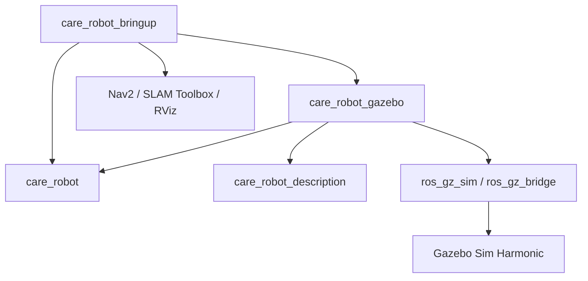
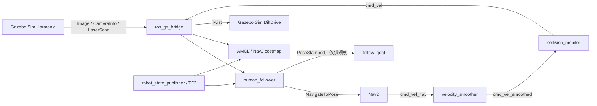

# 项目架构

## 包依赖



`care_robot_bringup` 是面向用户的总入口。`care_robot_gazebo` 管理仿真与桥接，
`care_robot_description` 提供机器人模型，`care_robot` 保存运行节点和可单测算法。
四个包按 ROS 2 的资源边界安装，launch 文件只通过 ament package index 查找路径。

## 仿真与导航数据流



相机输出 `rgb8` 和 `32FC1`。跟随节点直接解析 `sensor_msgs/Image`，无需依赖
`cv_bridge`。检测器在 MediaPipe 和 OpenCV HOG 之间
选择，随后把人体像素和深度投影到 optical frame，再通过 TF2 转到 `map`。

Nav2 使用 `NavigateToPose` action 接收更新后的跟随目标。Gazebo Sim 原生 DiffDrive
系统发布 `odom → base_link`，`ros_gz_bridge` 将 `/cmd_vel`、`/odom` 和 `/tf` 接到 ROS 2。

Nav2 参数采用 Jazzy 的 `::` 插件标识、`progress_checker_plugins` 列表和独立
navigator 配置，内置 BT 插件由 Nav2 自动加载。速度平滑器输出经过 collision monitor
后到达 `/cmd_vel`；各速度节点显式使用 `Twist`，与桥接和跟随节点一致。
标准 Nav2 bringup 也会启动 docking server，配置仅提供必要的插件类型，不定义充电站。
参数变化参见 [Nav2 Jazzy 迁移指南](https://docs.nav2.org/jazzy/configuration_and_development/migration_guides/iron/Iron/)。

## actor 非接触代理同步

```mermaid
flowchart LR
    W[maze4.world waypoint] --> P[actor_proxy_follower]
    C[/clock] --> P
    P -->|SetEntityPose| S[/world/default/set_pose]
    S --> B[actor_tracking_proxy]
```

Gazebo Sim Harmonic 的常规 pose topic 不包含脚本 actor 的根姿态。同步节点启动时读取
当前 world 文件，找到目标 actor 的 waypoint、循环设置和启动延迟。节点按照 `/clock`
计算插值姿态，再通过 `ros_gz_interfaces/srv/SetEntityPose` 移动隐藏代理。代理使用
`collide_bitmask=0`，不参与物理接触。当前人物模型原点采用 `z=1.0` 地面参考，代理
中心则换算到距地面 0.85 米的位置。world 文件是轨迹的唯一来源。

## 坐标系

```text
map
└── odom
    └── base_link
        ├── lidar
        │   └── care_robot/base_link/lidar_sensor
        └── camera_link
            └── camera_link_optical
                └── care_robot/base_link/robot_camera_sensor
```

Gazebo Sim 的传感器消息使用作用域 frame 名。仿真 launch 发布两个静态变换，把作用域
frame 接回 URDF 的 `lidar` 和 `camera_link_optical`。AMCL 发布 `map → odom`，原生
DiffDrive 发布 `odom → base_link`，整个 TF 树可以被 Nav2 和跟随节点共同使用。

## 配置边界

- 跟随算法和 ROS 接口参数放在 `care_robot_bringup/config/follower.yaml`
- 导航参数和 AMCL 初始位置放在 `care_robot_bringup/config/nav2_params.yaml`
- 建图参数放在 `care_robot_bringup/config/slam_toolbox.yaml`
- 地图和 RViz 配置随 `care_robot_bringup` 安装
- world、Gazebo model 和 actor 动画随 `care_robot_gazebo` 安装
- URDF 随 `care_robot_description` 安装

接入真机时可以新增硬件驱动启动文件，并保留 `care_robot` 中的感知和跟随逻辑。若要
替换人体检测器，建议让新检测器输出统一的人体像素或三维位置消息，再逐步把检测和
导航目标计算拆成两个节点。
